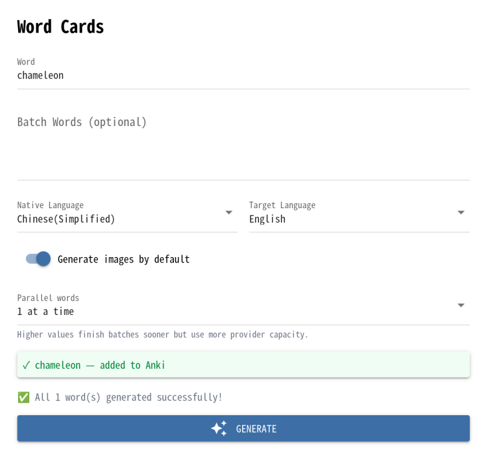
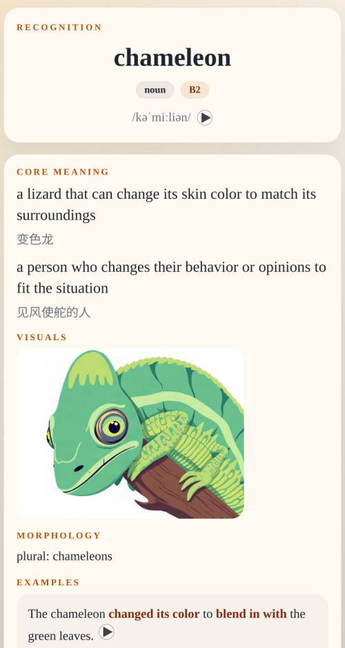

# AnkiNote

<p align="center">
  
</p>

<p align="center">
  <a href="https://pypi.org/project/ankinote-ai/"></a>
  <a href="https://pypi.org/project/ankinote-ai/"></a>
  <a href="https://github.com/ignity21/ankinote-ai/blob/main/LICENSE"></a>
  <a href="https://codecov.io/gh/ignity21/ankinote-ai"></a>
</p>

> AI-powered Anki card generator — vocabulary, phrases, sentences, and STEM concepts

## 📖 About

AnkiNote turns a word, phrase, sentence, or STEM concept into a finished Anki
note — definitions, examples, mnemonics, image, and audio — using your own API
key for Gemini, GPT, Claude, DeepSeek, or any other provider litellm supports.
It writes straight into an Anki collection that it keeps synced with AnkiWeb,
so a card added from your phone's browser shows up on every Anki client.

## 🚀 Quick Start

The only prerequisite is [uv](https://docs.astral.sh/uv/getting-started/installation/)
(`curl -LsSf https://astral.sh/uv/install.sh | sh`); uv downloads a suitable
Python by itself. Then:

```bash
uvx --from 'ankinote-ai[headless]' ankinote-gui
```

The Web UI opens at <http://localhost:8080>. In **Settings**:

1. **Anki Backend** → *Direct collection (no desktop app needed)* → **Use
   default** → **Apply**.
2. **AnkiWeb sync** → **Log in and sync** with your AnkiWeb account. Cards can
   be saved once the first sync finishes; if AnkiWeb already has your
   collection, choose **Use the data on AnkiWeb** when asked.
3. **Generation route** → add a profile with your API key (Gemini, OpenAI,
   DeepSeek, …). Image and TTS keys are optional.

Then type a word on the **Word** page. The note type and deck are created on the
first save, and the card reaches your other Anki clients on their next sync.

To keep it installed instead of fetching it on each run:
`uv tool install 'ankinote-ai[headless]'`, then run `ankinote-gui`. For a
server or NAS, use [Docker](#run-the-web-ui-with-docker).

**Already run Anki Desktop?** Skip steps 1 and 2: install the
[AnkiConnect](https://ankiweb.net/shared/info/2055492159) add-on, keep Anki
open, and leave the backend on *AnkiConnect*. See
[Which Anki backend?](#which-anki-backend).

## ✨ Features

- 🖥️ **Web UI** - Providers, keys, backend, and AnkiWeb login are all set from
  the browser — no `.env` file or restart needed
- 🔌 **Two Anki Backends** - the in-process `collection` backend runs
  standalone and syncs with AnkiWeb, no Anki app required; `connect` plugs into
  a running Anki Desktop through AnkiConnect
- 🤖 **Multi-Provider AI** - Powered by litellm: Gemini, GPT, Claude, DeepSeek,
  and any OpenAI-compatible endpoint for text
- 🖼️ **AI Image Generation** - OpenAI (gpt-image), Gemini, or fal.ai
- 🔊 **Audio Generation** - Text-to-Speech using Google Cloud TTS API
- 📝 **Dual-Direction Cards** - Supports both word→definition and definition→word learning modes
- 🎨 **Beautiful Templates** - Built-in Light/Dark mode responsive card templates
- ⚡ **Batch Processing** - Generate multiple cards from word lists efficiently (CLI)
- 🌐 **Multi-Language** - Learn English, French, Spanish, German, or Japanese,
  with explanations in any of those or Chinese and Korean
- 🧮 **STEM Concepts** - Math, science, and programming concept cards with MathJax rendering

AnkiNote has two front ends that share the same card-generation engine and the
same settings file:

- **Web UI** (`ankinote-gui`) — start here.
- **CLI** (`ankinote`) — scriptable, batch-friendly. Bare `ankinote` opens an
  interactive terminal menu for provider profiles, Anki backend, and the TTS
  key. See the [CLI usage guide](docs/cli-usage.md).

---

## 🖥️ Web UI

### Launching

```bash
uvx --from 'ankinote-ai[headless]' ankinote-gui   # one-off, nothing installed
ankinote-gui                                      # after `uv tool install`
uv run ankinote-gui                               # from a source checkout
```

This opens `http://localhost:8080` in a browser (set `ANKINOTE_SHOW=false` to
skip auto-open, e.g. on a headless server). The UI has six pages, reachable
from the left drawer: **Word**, **Phrases**, **Sentences**, **STEM**, **Card
Types** (note type + deck setup), and **Settings**.

### Which Anki backend?

- **`collection`** (recommended) — AnkiNote opens the collection file itself,
  no Anki app involved, and keeps it synced with AnkiWeb on its own. Your
  phone, desktop, and AnkiWeb all see new cards after a normal sync, and
  AnkiNote can run as a long-lived service on a server, NAS, or in
  [Docker](#run-the-web-ui-with-docker). Needs the `ankinote-ai[headless]`
  extra (included in the commands above and in the Docker image).
- **`connect`** — talks to an Anki Desktop you already have open, via the
  AnkiConnect add-on. Cards land in your open collection immediately; Anki
  Desktop syncs them as usual. This is the default until you switch.

Pick one under **Settings → Anki Backend** and press **Apply**; the choice is
saved and used on the next start too. Both work identically from the Web UI and
CLI.

### Example

Generating a card for **chameleon** from the Word page:



The resulting card, reviewed in Anki:



### Configuration — all in the Settings page

Settings are saved to `~/.config/ankinote/settings.json` (shared with the CLI)
and applied immediately; nothing needs to be in a `.env` file.

- **Anki Backend** — `collection` or `connect` (see above), and the collection
  file path for `collection`.
- **Generation route (text)** and **Image route** — each is a rack of named
  provider profiles. Pick a vendor template (OpenAI, Anthropic, Gemini, Fal,
  etc.) or "Custom / Other" for any OpenAI-compatible endpoint, then fill in
  base URL, model (with a refresh button to fetch live model IDs), and API
  key. Multiple profiles per vendor are supported (e.g. two OpenAI accounts),
  and you switch which one is active by clicking its pill.
  - For Fal image generation, use a `Fal` profile with base URL
    `https://fal.run` and your Fal API key, with a full endpoint id such as
    `fal-ai/z-image/turbo`.
- **TTS (Google Cloud)** — paste the Google Cloud TTS API key.
- **Defaults** — native/target language and whether image generation is on by
  default for new cards.
- **AnkiWeb sync** — shown when the `collection` backend is active:
  login/logout, sync status, manual sync, sync interval, and the
  upload/download choice on a required full sync.
- **Backup & transfer** — export all provider profiles + the TTS key as a
  passphrase-encrypted JSON bundle (scrypt + AES-256-GCM), and import one back
  in, merged by profile name. Useful for moving settings between machines or
  backing them up.

### Environment variables (optional)

None are needed for local use. They cover process-level options and
deployments:

| Variable | Default | Purpose |
| --- | --- | --- |
| `ANKINOTE_HOST` / `ANKINOTE_PORT` | `0.0.0.0` / `8080` | Bind address for the web server |
| `ANKINOTE_SHOW` | `true` | Whether to auto-open a browser tab on start |
| `ANKINOTE_STORAGE_SECRET` | generated | NiceGUI session-signing key. Generated on first start and kept in `~/.config/ankinote/storage_secret`; set it only to manage the secret yourself |
| `ANKI_BACKEND` / `ANKI_COLLECTION_PATH` | unset (acts as `connect`) / – | Initial backend and collection file, used until a backend is saved on the Settings page (after that, `settings.json` wins) |
| `ANKI_CONNECT_URL` | `http://localhost:8765` | Where AnkiConnect lives (`connect` backend) |
| `ANKIWEB_USERNAME` / `ANKIWEB_PASSWORD` | – | Configure the `collection` backend's AnkiWeb login externally instead of through the Settings page; overrides a UI login, password never persisted to disk |
| `XDG_CONFIG_HOME` | `~/.config` | Parent directory of `ankinote/settings.json` |

### Collection backend: sync and data

The `collection` backend synchronizes with AnkiWeb at startup, after each note
save or note-type setup batch, and every five minutes. A fresh collection
blocks writes until its initial sync completes; an initialized collection
remains writable offline. A required full sync blocks writes until you resolve
the upload/download choice, in the Settings page or via `ankinote anki sync`.

Data is stored in the directory containing the collection file (by default
`~/.local/share/ankinote/`). Beside the collection file, `.sync.json` stores
credential-free status, `.credentials.json` stores saved login credentials with
mode `0600`, `.account` retains an account binding after logout, and `.backups/`
holds recoverable collection backups made before full sync. Logout removes the
saved credential and pauses synchronization without deleting the collection or
media. Use a different data directory to switch accounts. Open a collection from
only one process at a time.

### Run the web UI with Docker

Published images (multi-arch `amd64` + `arm64`): `ghcr.io/ignity21/ankinote-ai`
and `ignity21/ankinote-ai` (Docker Hub), tags `latest`, `<major>.<minor>`, and the
exact version.

Two ready-made compose stacks under [`deploy/`](deploy/):

```bash
cd deploy/standard        # GUI + an AnkiConnect you already run
# or: cd deploy/headless  # standalone service — no Anki app, syncs itself to AnkiWeb
cp .env.example .env      # optional: AnkiWeb login (headless), port, image tag
docker compose up -d      # http://localhost:8080
```

AI provider keys are added in the web UI (Settings page), not `.env`. See
[`deploy/README.md`](deploy/README.md) for the difference between the stacks, the
AnkiConnect host setup, and building locally. The published image bundles the
`anki` library, so both backends work without a custom build.

---

## ⌨️ CLI

For scripting and batch runs, `ankinote` provides `word` / `phrase` /
`sentence` / `stem` subcommands. It reads provider profiles and the Anki
backend from the same `settings.json` the Web UI writes — run bare `ankinote`
for an interactive menu to manage them, or pass `--profile`/`--image-profile`
to pick one by name (`ankinote profiles list --json` shows what's
configured); `.env` / environment variables still work as a fallback. See
the [CLI usage guide](docs/cli-usage.md) for setup and the full command
reference — most users should start with the Web UI above instead.

## 📦 Tech Stack

- **Language**: Python 3.14+
- **Package Manager**: uv
- **AI/ML**: litellm (OpenAI, Gemini, Claude, DeepSeek, fal.ai, etc.)
- **TTS**: Gemini, OpenAI, or Google Cloud Text-to-Speech
- **Image Generation**: OpenAI (gpt-image), Gemini, fal.ai
- **Anki Integration**: in-process `anki` library with AnkiWeb sync, or AnkiConnect
- **Card Templates**: HTML + CSS

## 🔧 API Services

### AI Provider (via litellm)
- Text generation for definitions, examples, and mnemonics
- Image generation (OpenAI gpt-image, Gemini, fal.ai) for card visuals
- Supports Gemini, GPT, Claude, DeepSeek, Qwen, and more

### Text-to-speech
- Gemini (same AI Studio key as text and images), OpenAI, or Google Cloud
  Text-to-Speech (its own Cloud API key, `GOOGLE_TTS_KEY`)
- A random voice per clip; audio is stored as MP3

### Anki
- `collection`: opens the collection in-process and syncs it with AnkiWeb
- `connect`: talks to a running Anki Desktop through AnkiConnect

## 🛠️ Development

```bash
# Clone the repository
git clone https://github.com/ignity21/ankinote-ai.git
cd ankinote-ai

# Install the project and development dependencies
uv sync

# Run tests
make test

# Format code
make format

# Type checking
make check
```

## Documentation
- [CLI Usage Guide](docs/cli-usage.md)
- [Note Types](docs/NoteType.org)
- [Skill](.agents/skills/ankinote-cli/SKILL.md) — for using AnkiNote with AI coding assistants

## 📄 License

MIT License - see [LICENSE](LICENSE) file for details
